# Ontology modeling and quality-gated AI knowledge

## Scope and evidence

This guide describes a proposed connected architecture, not running services.
**Fabric IQ ontology is preview.** Fabric and Microsoft Purview are connected
platforms, not capabilities silently included in a minimal Foundry resource or
the USD 100/month demo target.

See the [source register](architecture-sources.md) for the actual verification
timestamp, claim boundaries and reproduction commands. Documentation verification
does not validate your tenant settings, licensing, regional access, permissions,
connectors, deployment or AI answer quality.

## 1. Model business meaning, not another database

An **entity type** defines a business concept. An **instance** is an occurrence
resolved from source data. Properties describe it; relationship types describe
how concepts connect. A binding maps those definitions to the source structures.
Ontology is a context/semantic layer, not a replacement for the source's query
engine, storage, permissions or truth.
([Microsoft overview](https://learn.microsoft.com/fabric/iq/ontology/overview))

### Fictional `demo.commerce` model

| Entity type | Identifier and illustrative properties | Proposed source binding |
|---|---|---|
| Customer | `customerId`, `segment` | Curated `Customers` table |
| Order | `orderId`, `customerId`, `status`, `amount` | Curated `Orders` table |
| OrderLine | `lineId`, `orderId`, `productId`, `quantity` | Curated `OrderLines` table |
| Product | `productId`, `category` | Curated `Products` table |

| Relationship | Business intent | Example binding |
|---|---|---|
| Customer **places** Order | One customer can place many orders | Match `Customer.customerId` to `Order.customerId` |
| Order **contains** OrderLine | One order can contain many lines | Match `Order.orderId` to `OrderLine.orderId` |
| OrderLine **refers to** Product | Many lines can refer to one product | Match `OrderLine.productId` to `Product.productId` |

These cardinalities are the fictional workload's design intent. They are **not**
a claim that merely drawing or naming a Fabric relationship enforces relational
constraints. Review origin/target properties and use a supported mapping table
when the relationship requires it.
([Relationship authoring](https://learn.microsoft.com/fabric/iq/ontology/how-to-create-relationship-types))

[Download the synthetic model](assets/ontology-example.json). Its JSON is an
explanatory repository contract, **not an official Fabric import/API schema**.
It contains no customer records, emails, credentials or sensitive business data.

### Definitions, source-owned metrics, and graph execution

- Use namespaces and ownership to distinguish similarly named concepts.
- Preserve source-owned metrics rather than inventing a second calculation.
- Natural-language ontology rules provide shared reasoning context. They are not
  an automatic authorization, data-validation or policy-enforcement mechanism.
- Source data remains at the bound source. Consumers require appropriate source
  access; ontology is not a permission bypass.
- Optional graph execution requires an explicit materialization decision.
  An ontology-derived graph schema does not automatically load instance data.
- This guide does not promise a working Foundry-to-Fabric connector. A future
  adapter must be verified against its supported API, permissions and preview
  prerequisites before being labeled live.

These boundaries follow the [ontology overview](https://learn.microsoft.com/fabric/iq/ontology/overview).
Fabric capacity, tenant/item settings, supported source shape and permissions
remain prerequisites, not completed tasks.

## 2. Improve data progressively, then assess and gate publication

1. **Bronze:** preserve the original synthetic source and its lineage.
2. **Silver:** standardize types, handle nulls, deduplicate and explicitly validate.
3. **Gold:** publish a curated, owned data product with a known version.
4. **Assess:** configure Purview connections, profiling, rules and scans for
   supported assets. Record which rules and source snapshot were assessed.
5. **Gate:** an owned pipeline makes the explicit publish/stop/remediate decision.
6. **Index:** only approved snapshots become candidate retrieval content.
7. **Evaluate answers:** measure grounding, citation support and failure behavior
   separately from source-data scores.

The first three stages follow Microsoft's
[OneLake medallion pattern](https://learn.microsoft.com/fabric/onelake/onelake-medallion-lakehouse-architecture).
Purview's [data-quality lifecycle](https://learn.microsoft.com/purview/unified-catalog-data-quality)
requires registration/scanning, a data product, permissions, a configured
connection, rules, and assessments. The [supported-source matrix](https://learn.microsoft.com/purview/unified-catalog-data-quality-supported-sources-file-formats)
includes Fabric lakehouse and relevant Delta/Parquet formats. Verify the current
regional, connection, identity and source-specific limitations before deployment.

### Illustrative quality contract

The dimensions below use Microsoft's terminology. Thresholds are **original demo
policy examples**, not Microsoft defaults, measured scores or guarantees.

| Dimension | Example check | Illustrative publish policy |
|---|---|---|
| Completeness | `Order.orderId` and `Order.customerId` are non-null/non-blank | 100% of rows |
| Uniqueness | No duplicate `Order.orderId` values | 100% unique after explicit completeness checks |
| Consistency | Every order's customer identifier resolves to the curated Customer set | No orphan references |
| Conformity | `status` belongs to the agreed enum; identifiers follow the agreed format | No out-of-contract values |
| Accuracy | Amount matches an authoritative synthetic fixture or independently governed source | No known mismatches; no truth claim without an oracle |
| Freshness | Assessed asset modification metadata meets the agreed SLA | Example: no older than 24 hours |

Purview documents these six dimensions in its
[overview](https://learn.microsoft.com/purview/unified-catalog-data-quality).
Check actual [rule semantics](https://learn.microsoft.com/purview/unified-catalog-data-quality-rules):
uniqueness rules can ignore nulls unless paired with an empty/blank rule, and
the built-in freshness rule uses asset last-modified information. Do not silently
substitute an arbitrary business timestamp for that rule's semantics.

### Assessment is not enforcement

Purview provides profiling, assessments, scores, actions and alerts. A score does
not automatically stop indexing or quarantine data. The workload needs an
explicit orchestrated gate and a defined failure owner.

Fabric [materialized lake view quality constraints](https://learn.microsoft.com/fabric/data-engineering/materialized-lake-views/data-quality)
provide transformation-time enforcement. For documented row-level constraints,
`FAIL` stops refresh and `DROP` excludes violating rows. Explicitly preserving
rejected records in a quarantine path is still a pipeline design choice; do not
claim that `DROP` automatically creates such a store. Column-wide quality checks
also differ from row-local predicates.

For this proposed showcase, **unknown**, **failed**, **stale**, or **unreviewed**
quality evidence should stop publication. This is a recommended repository
contract, not a currently implemented control.

### Required lineage for a published retrieval snapshot

Record source and schema version, ontology definition/binding version where
relevant, rule-set version, scan time and result, decision owner, approval,
content classification, index version and retention policy. Make deletion and
re-indexing behavior explicit.

Data quality, ontology meaning, access control, and model evaluation are four
different concerns. A complete dataset can still be wrong; a correct dataset can
still be unauthorized; a grounded model can still fail an output contract.

## 3. What is verified here

- The cited public Microsoft pages were reviewed for the stated boundaries.
- The reproducible verifier checks HTTP accessibility and evidence terms.
- Official icon archive/file digests and unchanged embedded artwork are checked.
- Generated SVG, editable sources, source references and local links are tested.

**Not verified:** deployed Fabric/Purview resources, live data quality scans,
real ontology bindings, authorization enforcement, live retrieval or model
evaluation. No cloud services were created to produce these documents.
