# Azure Foundry IRL: reference architecture atlas

Original reference designs grounded in public Microsoft documentation. Documentation and asset provenance are verified; these systems are not deployed, certified, or cloud-tested.

Source review and automated public-page checks: **2026-10-27**.

These are original adaptations, not Microsoft-endorsed diagrams. Official Microsoft artwork is used only to label its products; generic business/application nodes have no Microsoft logo.

## Reading the diagrams

Solid arrows show primary flow or a semantic relationship. Dashed arrows show supporting evidence, control, returns or sequence lifelines. Frames are logical boundaries, not claims about physical resource placement.

Each SVG is self-contained, and each editable Excalidraw source embeds the same unmodified icon bytes. The microsite embeds its diagrams so viewing never requires a CDN, remote renderer or Azure credentials.

## Lean showcase topology

**Profile:** Proposed demo baseline. **Deployment:** not deployed.

A public, static learning surface is separated from authenticated, metered Azure execution.

[SVG](assets/diagrams/lean-demo-topology.svg) | [Editable Excalidraw](assets/diagrams/lean-demo-topology.excalidraw)

**Boundary:** Original application design. The 900-second session and three daily starts are application policies, not Entra token settings.

### Flow and source mapping

1. GitHub Pages serves public learning content; only the backend may call paid services. GitHub hosting is a user-selected boundary, not a Microsoft-hosting claim. ([MS04](https://learn.microsoft.com/azure/container-apps/overview))
2. Entra External ID supplies email-OTP authentication. Backend approval, token validation, a non-renewable 900-second application session and three starts per UTC day remain custom requirements. ([MS05](https://learn.microsoft.com/entra/external-id/customers/how-to-user-flow-sign-up-sign-in-customers), [MS06](https://learn.microsoft.com/azure/storage/tables/table-storage-design))
3. Conditional ledger writes precede paid work. A global spending reservation and a per-identity session transaction must not be mistaken for one cross-partition transaction. ([MS06](https://learn.microsoft.com/azure/storage/tables/table-storage-design))
4. AI modules are activated only after price, quota, regional and access checks. The architecture does not promise a hard Azure billing cap. ([MS14](https://learn.microsoft.com/azure/foundry/concepts/manage-costs))

### Design decisions

- Keep secrets and paid execution out of the public origin.
- Use durable, idempotent accounting rather than browser timers or process memory.
- Separate usage telemetry from admission control; delayed billing data cannot enforce a real-time allowance.

### Limitations and activation gates

- Not deployed. Authentication, quotas and live execution remain unimplemented.
- This is not a complete production security or private-network design.
- AI tools, retrieval, media, Fabric and Purview are not automatically included in the $100 target.

## Enterprise private-connectivity pattern

**Profile:** Enterprise reference - separate cost profile. **Deployment:** not deployed.

A simplified adaptation of Microsoft's baseline Foundry chat architecture, not a replacement for its full network design.

[SVG](assets/diagrams/enterprise-private-topology.svg) | [Editable Excalidraw](assets/diagrams/enterprise-private-topology.excalidraw)

**Boundary:** Service icons on the right represent managed PaaS resources. They are not depicted as compute deployed inside the workload VNet.

### Flow and source mapping

1. The baseline routes inbound traffic through Application Gateway/WAF to an App Service chat UI. The UI authenticates to Foundry using managed identity and private reachability. ([MS03](https://learn.microsoft.com/azure/architecture/ai-ml/architecture/baseline-microsoft-foundry-chat))
2. Standard agent setup uses workload-owned network and dedicated agent-managed resources. Application session/quota tables must be separate from agent-managed stores. ([MS03](https://learn.microsoft.com/azure/architecture/ai-ml/architecture/baseline-microsoft-foundry-chat))
3. The agent can query AI Search, invoke its model, and persist conversation items. Public tool egress requires the baseline's outbound controls; private tool paths remain private. ([MS03](https://learn.microsoft.com/azure/architecture/ai-ml/architecture/baseline-microsoft-foundry-chat))
4. This enterprise pattern has a separate cost and reliability profile. It is not silently included in a consumption demo budget. ([MS14](https://learn.microsoft.com/azure/foundry/concepts/manage-costs))

### Design decisions

- Use the complete Microsoft baseline for subnet sizing, DNS, egress, access, availability and deployment details.
- Keep agent-managed state exclusive to Agent Service.
- Treat private networking as connectivity control, not a substitute for authorization.

### Limitations and activation gates

- Adapted excerpt, not Microsoft's unmodified official diagram or a deployable network specification.
- DNS, individual private endpoints, availability zones, build infrastructure and detailed routes are intentionally not expanded.
- No enterprise resources or private endpoints have been provisioned.

## Visitor admission and session sequence

**Profile:** Application contract - not implemented. **Deployment:** not deployed.

Authentication, application session admission, and paid-action authorization are three distinct decisions.

[SVG](assets/diagrams/visitor-session-sequence.svg) | [Editable Excalidraw](assets/diagrams/visitor-session-sequence.excalidraw)

**Boundary:** The short application session is independent of identity-token lifetime. Unknown accounting, expired sessions and exhausted allowances must deny paid work.

### Flow and source mapping

1. External ID manages email OTP. Successful authentication does not imply that this application's visitor allowlist or spending policies have approved access. ([MS05](https://learn.microsoft.com/entra/external-id/customers/how-to-user-flow-sign-up-sign-in-customers))
2. A successful, idempotent start reserves one of three sessions for the approved identity in a UTC calendar day. The API sets an absolute expiry 900 seconds after creation. ([MS06](https://learn.microsoft.com/azure/storage/tables/table-storage-design))
3. Each paid action checks expiry and reserves bounded usage before provider execution. Use ETags and partition-aware transactions; compensate or safely retain failed reservations rather than permit overspend. ([MS06](https://learn.microsoft.com/azure/storage/tables/table-storage-design), [MS14](https://learn.microsoft.com/azure/foundry/concepts/manage-costs))
4. Streams, voice and tool loops must stop at the application deadline. Refreshing an identity token must not extend that deadline. ([MS05](https://learn.microsoft.com/entra/external-id/customers/how-to-user-flow-sign-up-sign-in-customers), [MS14](https://learn.microsoft.com/azure/foundry/concepts/manage-costs))

### Design decisions

- Treat 900 seconds and three daily starts as repository policy, not Microsoft service defaults.
- Never claim cross-partition atomicity in Azure Tables.
- Use explicit rejection paths for approval, capacity, quota, price or ledger failures.

### Limitations and activation gates

- Sequence specification only; no OTP, session or payment enforcement is implemented.
- OIDC/MSAL protocol exchanges are intentionally abstracted; a real implementation must validate access tokens for its configured issuer/audience/scopes.
- Three identities do not prove three distinct humans; approval and abuse controls remain necessary.

## Grounded agent request sequence

**Profile:** Adapted Microsoft enterprise flow. **Deployment:** not deployed.

Trace the path from an authenticated UI through retrieval, model execution, conversation state and a grounded response.

[SVG](assets/diagrams/grounded-agent-sequence.svg) | [Editable Excalidraw](assets/diagrams/grounded-agent-sequence.excalidraw)

**Boundary:** This adapts the baseline's agent workflow. Source references must be validated; a model answer alone is not evidence that a source supports it.

### Flow and source mapping

1. The App Service caller uses managed identity and the baseline's private path to invoke the agent with the user query and conversation context. ([MS03](https://learn.microsoft.com/azure/architecture/ai-ml/architecture/baseline-microsoft-foundry-chat))
2. Agent Service orchestrates the configured search tool, then its configured language model with relevant grounding context. The diagram does not assume public search or anonymous data access. ([MS03](https://learn.microsoft.com/azure/architecture/ai-ml/architecture/baseline-microsoft-foundry-chat))
3. Under standard agent setup, Agent Service manages the dedicated Cosmos DB conversation store. It is not a general application session database. ([MS03](https://learn.microsoft.com/azure/architecture/ai-ml/architecture/baseline-microsoft-foundry-chat))
4. The UI receives the result and any available source references. Application acceptance should check relevant evidence, citations, policy failures, empty retrieval and timeouts. ([MS03](https://learn.microsoft.com/azure/architecture/ai-ml/architecture/baseline-microsoft-foundry-chat))

### Design decisions

- Treat retrieved text as untrusted input, not authorization or executable instructions.
- Keep conversation retention separate from the short visitor-session contract.
- Include negative cases and evidence checks in the eventual evaluation harness.

### Limitations and activation gates

- Conceptual ordering; internal model/tool iterations can vary by agent configuration.
- No claim is made that references guarantee truth or that this repository has passed live grounding evaluations.
- Agent Service standard setup is distinct from a minimal basic demo setup.

## Business ontology and source bindings

**Profile:** Connected Fabric IQ preview - optional. **Deployment:** not deployed.

A fictional commerce vocabulary makes entity types, properties, relationships and their source bindings explicit.

[SVG](assets/diagrams/ontology-business-model.svg) | [Editable Excalidraw](assets/diagrams/ontology-business-model.excalidraw)

**Boundary:** Ontology supplies business context, not a new general-purpose query engine. Graph materialization is optional, not automatic.

### Flow and source mapping

1. Define reusable entity types and typed properties in the synthetic demo.commerce namespace. An entity type is a definition; an entity instance is a data-backed occurrence. ([MS07](https://learn.microsoft.com/fabric/iq/ontology/overview))
2. Declare Customer places Order, Order contains OrderLine, and OrderLine refers to Product. The illustrated one-to-many business intent is a demo contract, not an asserted automatic Fabric cardinality constraint. ([MS07](https://learn.microsoft.com/fabric/iq/ontology/overview), [MS08](https://learn.microsoft.com/fabric/iq/ontology/how-to-create-relationship-types))
3. Bind identifiers and relationship properties to governed source tables. Direct-column or mapping-table bindings depend on the relationship and supported source shape. ([MS08](https://learn.microsoft.com/fabric/iq/ontology/how-to-create-relationship-types))
4. Supported consumers use the ontology's context and authorized bound sources. A graph schema does not automatically load instance data; opt-in graph execution needs separate decisions. ([MS07](https://learn.microsoft.com/fabric/iq/ontology/overview))

### Design decisions

- Do not confuse an ontology, a relational schema, a Purview glossary, a vector index or an LLM prompt.
- Natural-language ontology rules convey context; enforceable quality/security constraints still need explicit implementation.
- Keep source-owned calculations and access controls at their authoritative sources.

### Limitations and activation gates

- Fabric IQ ontology is preview, not a Foundry-native capability or deployed component of this repo.
- Requires appropriate Fabric capacity, item permissions, tenant settings and supported bindings.
- The downloadable synthetic model is explanatory JSON, not a supported Fabric import or deployment format.

## Quality-gated knowledge publication

**Profile:** Optional Fabric + Purview reference. **Deployment:** not deployed.

Separate data refinement, governance assessment and an explicitly owned publication gate before AI retrieval.

[SVG](assets/diagrams/data-quality-publication.svg) | [Editable Excalidraw](assets/diagrams/data-quality-publication.excalidraw)

**Boundary:** Purview assesses configured quality rules. Blocking publication and quarantining data are explicit pipeline responsibilities, not an automatic Purview side effect.

### Flow and source mapping

1. Preserve source data in bronze; standardize and validate in silver; publish curated products in gold. Separation and ownership are deliberate parts of the medallion pattern. ([MS09](https://learn.microsoft.com/fabric/onelake/onelake-medallion-lakehouse-architecture))
2. Register and scan sources, assign a data product, configure a quality connection, profile, define rules and run assessments. Purview can assess supported Fabric lakehouse/Delta data subject to source, identity and regional prerequisites. ([MS10](https://learn.microsoft.com/purview/unified-catalog-data-quality), [MS12](https://learn.microsoft.com/purview/unified-catalog-data-quality-supported-sources-file-formats))
3. Measure the documented dimensions: completeness, consistency, conformity, accuracy, freshness and uniqueness. Use rule-specific semantics; uniqueness alone can ignore nulls without an empty/blank check. ([MS10](https://learn.microsoft.com/purview/unified-catalog-data-quality), [MS11](https://learn.microsoft.com/purview/unified-catalog-data-quality-rules))
4. Implement the owned gate before indexing. Fabric transformation constraints can FAIL or DROP records; explicit quarantine, thresholds, sign-off and publication orchestration remain workload decisions. ([MS13](https://learn.microsoft.com/fabric/data-engineering/materialized-lake-views/data-quality), [MS11](https://learn.microsoft.com/purview/unified-catalog-data-quality-rules))
5. Record dataset version, rule version, scan evidence, owner and approval with the retrieval snapshot. A high quality score is not proof of factual truth, safe access or grounded model output. ([MS10](https://learn.microsoft.com/purview/unified-catalog-data-quality), [MS11](https://learn.microsoft.com/purview/unified-catalog-data-quality-rules))

### Design decisions

- Do not publish on an unknown, failed or stale quality assessment.
- Distinguish source-data quality from ontology semantics and LLM answer evaluation.
- Define accuracy against an authoritative oracle; use known synthetic truth only for local examples.

### Limitations and activation gates

- Reference architecture only: Fabric/Purview capacity, connectors, scans and indexing are not provisioned.
- Regional co-location, managed-identity permissions, supported formats and current connector restrictions require preflight verification.
- Example thresholds are demo policy, not Microsoft defaults or measured cloud scores.
